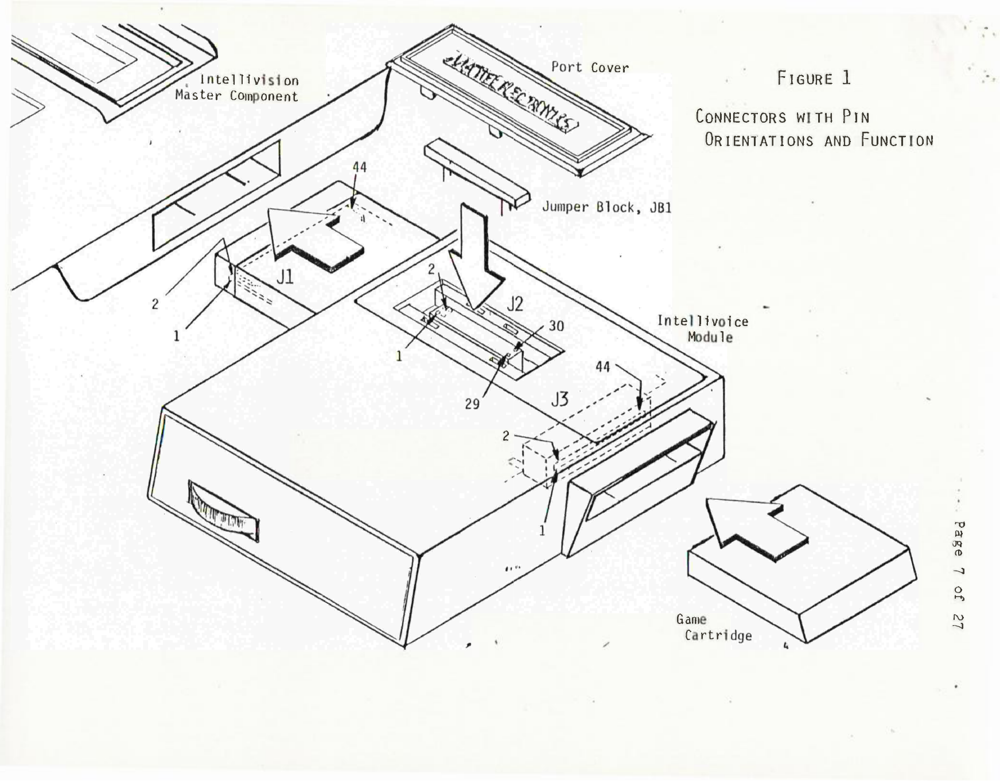
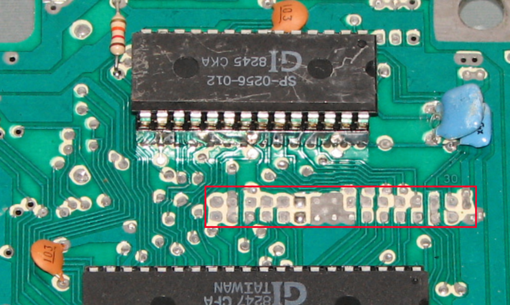
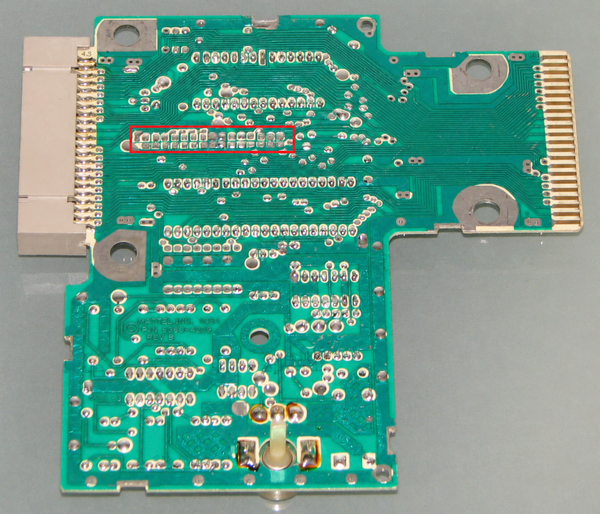

# J2 Stacking Connector Reverse-Engineering Guide

## Purpose

This guide records what is known about the Intellivoice Model 3330's J2 stacking connector and defines a safe process for determining its mating interface. It is intended to support a non-destructive breakout or peripheral adapter without risking scarce original hardware.

J2 is located beneath the removable top cover. It is a 30-contact connector intended for a future peripheral family, not a standard external port with a documented retail mating plug.

## Known facts

| Item | Evidence |
| --- | --- |
| Function | J2 is the top-mounted stacking connector intended for future Intellivision peripherals. |
| Contact count | 30 contacts, numbered from 1–30 in the product specification's connector-orientation drawing. |
| Documentation part number | Mattel part `0089-0021`, described in the service-manual parts list as “Connector, Stacking 30 pin.” |
| Default configuration | A removable jumper block is fitted when no peripheral is attached. The product specification calls it `JB1`, part `3330-9609`; the service-manual scan labels the jumper `JB2`. Treat the differing designators as a documentation discrepancy, not as two jumpers. |
| Required jumper paths | The jumper electrically joins pins 3–4 and 27–28. Without it, the Intellivoice/cartridge path will not operate correctly. |
| Bus capability | J2 carries an 8-bit bidirectional data bus, control signals, peripheral selection signals, and a routed Master Component clock. |

The Rev B board photographs published by The Liberator show something important: at the J2 location there is a **2×15 plated-through-hole footprint**, between the SP-0256 speech synthesizer and SPB-640 buffer/interface ICs. No connector body is visible, and many of the holes appear solder-filled. The board silkscreen marks the far end `30`.

The photograph alone cannot distinguish between a factory-disabled/filled footprint and a connector that was removed before photography. It therefore demonstrates that no accessible socket/header is present in that photo, but does not establish the original production configuration.

The included documentation does **not** identify the connector manufacturer, series, pitch, plating, keying dimensions, mating part number, or mating insertion direction. It also does not resolve whether every production revision populated J2 or how a production unit without it implemented the documented jumper paths. Those are reverse-engineering targets.

## Visual references

Figure 1 is the view cited by the product specification. It locates J2 below the removable port cover, depicts the removable jumper block, and gives J2's pin orientation: 1/2 at one end and 29/30 at the other.

The accompanying [specification excerpt](../images/intellivoice-j2-stacking-connector-specification.png) describes the top-mounted stacking connector's intended peripheral role. The [unannotated board crop](../images/intellivoice-rev-b-j2-footprint.jpg) is from [The Liberator's Rev B reference photos](https://www.the-liberator.net/site-files/retro-games/hardware/Intellivision-Intellivoice/intellivision-intellivoice-voice-synthesis-module-rev-b.htm); the red outlines are the only annotations added.

## Safety rules

1. Do not power the Intellivoice until the original jumper block is present or its two required links have been verified on an adapter.
2. Do not inject power through J2. The specification mentions J2 pin 6 as a possible supply-boost input, but that is not an appropriate initial experiment.
3. Make passive measurements first. Never attach a microcontroller, USB adapter, pull-up, or logic output until voltage levels, direction, and timing are measured on a working unit.
4. Never force an unknown connector. A photograph or nominal contact count is insufficient to select a mating part.
5. Work ESD-safe and photograph the original configuration before removing the jumper.

## Phase 1 — document the original hardware

With the unit unpowered:

1. Photograph the port cover, J2, jumper block, and surrounding PCB from directly above and from both ends. Include a metric ruler and a known-scale object in at least one image.
2. Record the connector orientation using Figure 1 in the product engineering specification. It identifies pins 1/2 at one end and 29/30 at the other.
3. Measure and record:
   - contact-row count;
   - contacts per row;
   - centre-to-centre pitch along a row, preferably measured across ten or more intervals and divided by the number of intervals;
   - row-to-row spacing;
   - contact width, exposed length, and thickness;
   - plastic-body width, length, height, and any locating slots or polarizing features;
   - jumper dimensions, contacts, and insertion orientation.
4. Inspect the solder side, without desoldering, to determine whether J2 is populated. The photographed Rev B board has no visible connector body and appears to have solder-filled holes; other revisions may differ.

Do not infer the pitch from a low-resolution image. A measurement across multiple positions is much more reliable than measuring one spacing.

## Phase 2 — continuity map

Keep the unit unpowered and retain the jumper while mapping it.

1. Confirm continuity between J2 pins 3–4 and 27–28 through the installed jumper.
2. Remove the jumper only after documenting its orientation. Confirm that those paths open when it is removed.
3. Use a multimeter to map each J2 contact to test points, integrated-circuit pins, console connector J1, and cartridge connector J3 where accessible.
4. Compare the results to Table 3 in the product engineering specification. The documented signals include `D0`–`D7`, `BC1`, `BC2`, `BDIR`, `AD0`–`AD2`, `RMHC`, and `MCLK`.
5. Record every result in a pinout table. Mark uncertain connections as unverified rather than guessing.

Suggested record format:

| J2 pin | Observed destination | Documented signal | Direction at J2 | Measurement status |
| --- | --- | --- | --- | --- |
| 1 |  |  |  | unverified |

## Phase 3 — identify a mating strategy

Only after physical measurements are available, search connector catalogs for a match. For a Rev B-style footprint with no accessible connector, first determine whether the holes are factory-filled or evidence of a removed part. Then measure exact pitch, hole diameter, row spacing, and clearance before selecting a replacement header or mating receptacle. No particular connector family should be assumed before measurement.

Prefer these approaches in order:

1. **Reversible mating connector:** a verified commercial receptacle that fully engages without force.
2. **Sacrificial replica/jumper:** reproduce the original jumper form factor first, proving mechanics and the two continuity paths before building an active board.
3. **Custom adapter:** a fabricated PCB or 3D-printed carrier with properly dimensioned contacts, only after the original geometry is measured.

Avoid soldering wires directly to J2 or modifying the Intellivoice PCB. A breakout should plug into J2 and be removable.

## Phase 4 — passive breakout validation

Build a passive adapter with no active ICs and no power injection.

- Preserve the 3–4 and 27–28 paths through the adapter.
- Break signals out to labelled test pads or a high-impedance logic analyzer.
- Include no pull-ups, pull-downs, level shifters, or USB power connection in the first revision.
- Verify continuity, isolation, and absence of shorts before installation.
- Power the Intellivoice with a known-good cartridge and verify normal operation before attaching measurement equipment.

The first live tests should merely observe signals. Confirm bus activity around writes in the documented `0x0800`–`0x0BFF` range with software known to access the Intellivoice.

## Phase 5 — active peripheral development

An active J2 device should be added only after the passive breakout is reliable.

1. Characterize signal voltage levels, timing, and data-bus direction with an oscilloscope or logic analyzer.
2. Use high-impedance, level-safe buffering.
3. Start with a device that does not drive the bus; add responses only when address selection and bus ownership are understood.
4. Use a custom test cartridge/program. Existing commercial games should not be expected to recognize a new peripheral.
5. Add current limiting, reverse-polarity protection, and a way to disconnect the adapter quickly.

## Open questions

- Which revisions actually populate J2, and are the solder-filled holes in the Rev B photo factory work or evidence of a removed connector?
- What are the footprint's pitch, hole diameter, row spacing, and permissible header height?
- What connector, if any, corresponds to Mattel part `0089-0021`?
- Are all 30 contacts assigned, grounded, or routed in the production revision being examined?
- Do revision differences exist between Intellivoice boards or jumper labels?
- Which device/address-selection behavior is most suitable for a modern J2 peripheral?

## Sources

- [Intellivoice Product Engineering Specification](CCF10232011_00021.pdf), especially Figure 1, Table 3, and sections 4.5 and 4.7.
- [Intellivoice Service Manual](Intellivoice_Service_Manual_1979_Mattel_US.pdf), especially the parts list and connector/jumper illustrations.
- [Rev B PCB photographs — The Liberator](https://www.the-liberator.net/site-files/retro-games/hardware/Intellivision-Intellivoice/intellivision-intellivoice-voice-synthesis-module-rev-b.htm).
- [Extension analysis](intellivoice-extension-analysis.md) for the historical and bus-level context.
